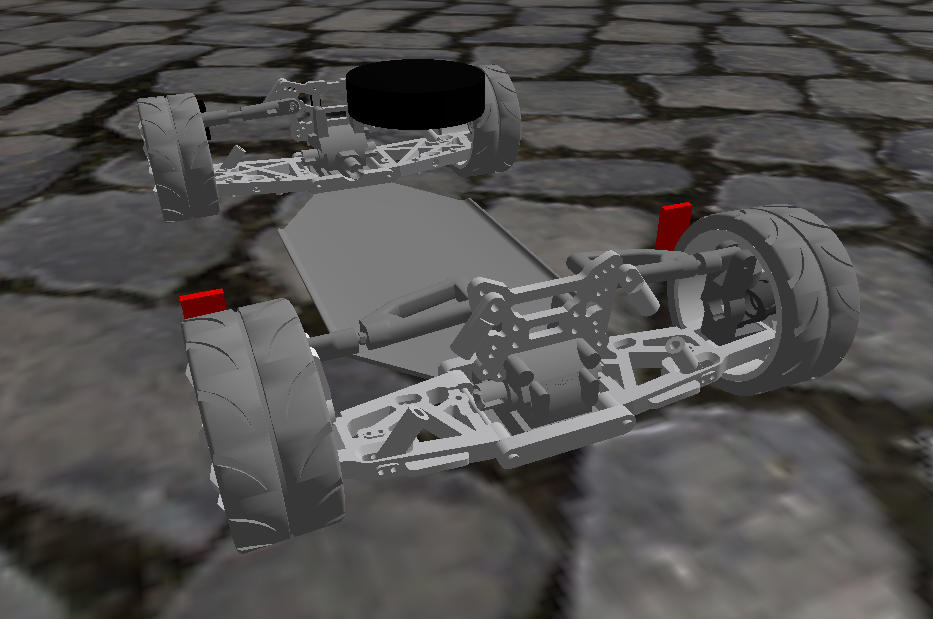

# car_damped

This model features a fully functional suspension system aka. being damped.

The suspension is modelled as a `double wishbone suspension` consisting of two wishbones, one steering knuckle and the middle part (spieder mount, differential) connecting this together.
This setup is known as a `4-bar linkage`. Another link for the suspension itself is connected between the middle part and the moving part of the `4-bar linkage`.

Disclaimer: The CAD model has a fatal flaw: The control arms are each an assembly themselves consisting of two components with a slider joint in between, to make them adjustable. This is actually realistic since those arms are used to adjust the camber of the wheels in reality. We, however, use them to make the wheels orientation a perfect 90 degree, so basically 0 camber. We can only reliably do so during assembly, then the slider is set so the constraint is satisfied and the control arms are fixed as rigid groups. So far so good. The issue is, FusionSDF cant export this setup. We therefore need to fix this by hand. The exact steps are described in the change protocol.



## Usage

In order to simulate the closed loop you need to use the `pgs` solver in the physics settings in the world sdf file. Also, you need to have a rather low time step. At least 0.001s or lower. The current default is 0.01s which is high enough for a model without closed loops, but not for this one. The default physics settings are in the `demo_gazebo/worlds/base_world.xacro` file.

## Fusion export

Automating the workflow from creating a CAD model, exporting it to SDF and making it ready to be used in a simulation is not at all possible without manual control.
Therefore, the following will describe this process. There is some work necessary by hand as well as using scripts. Down below there will be a detailed step by step change protocol.

It is a very error prone and meticulous task to create a CAD model, where you place joints, in what direction they point, how planes, axis, and whatnot are oriented has an influence on the simulation.
Ready yourself to a lengthy process of getting this right. It is advised to use various visualization tools in the gazebo gui: (Visualize joints, inertia, collisions. Best if you place the model onto some podest so the wheels can rotate without the vehicle moving. Then you can quite easily see if there are some imbalances. Looking at the simulated IMU will also tell you if your model vibrates in some capacity.)

## Postprocessing

The role of exporting the model from CAD is, first and foremost, the automatic calculation of the weight and inertia of all parts of the model as well as the placement of the joints. Beyond that it's nice for the visuals.

Collisions on the other hand, must be primitives defined in the SDF file itself. Round things such as the wheels must be represented as a sphere or cylinder, the rest not necessarily. If you provide any mesh format (stl, obj, ...) as a collision body, it will have countless edges. A sphere or cylinder will therefore never be really round, which leads to very bad vibration in the simulation. Therefore, it is mandatory to define primitive geometry as collisions.
It also makes a difference in computation whether the car is just a box or a detailed model with thousands of triangles. 

Since we cannot export the sdf in that way directly, we must perform various postprocessing steps. One of which is the removal of all collisions.
Later, we add the collisions separately.

Other postprocessing steps are:
- friction parameters on joints
- reusing geometry that is not being reused (the fusion export creates a geometry for every component, even if the components are referencing the same model)
- simplifying/optimizing/compressing the exported mesh data
- processing loops. You can define kinematic loops in the sdf, but you cannot load them. There is a workaround using DetachableJoints. Look at the simulation documentation for more details what this is about.

Under `demo_gazebo/scripts` you will find utilities and documentation that help to process the exported sdf file and meshes.

## Change protocol

- finish CAD
- export SDF using FusionSDF
- load into this directory
- Remove collisions: `python3 remove_collisions.py ../../models/car_damped/model.sdf ../../models/car_damped/model.sdf`
- Remove all joints where child and parent reference the same link. Bug stemming from the FusionSDF plugin exporting a rigid group. Even in the "dynamic" model, some parts of the suspension mechanism are combined into a rigid group.
- Replace "continuous" with "revolute" joints by hand
- remove base_link_joint and base_link link since those are unnecessary (later we add them again)
- remove links and associated meshes if they are not used by any joint. Happens when you create different rigid groups with the same components
- replace repeated components with only one instance. E.g. FusionSDF exports the 4 wheels as 4 distinct components. We only need one of them.
- Combine and optimize remaining meshes to the collada format. Collada because rviz2 doesnt seem to understand glb format: `python3 sdfopt.py --format dae /workspaces/ros2/src/demo_gazebo/models/car_damped`
- alter all mesh paths to begin with `package://demo_gazebo`. This is again a workaround to make sure the sdf file is understood both by gazebo and ros2. ros2 cant interpret the `model://car_damped` prefix.
- Regarding joints, fix all instances of `control_arm_rear/left_front/right_rg_1` with the correct rigid group link of the control arm that is meant to be connected at that joint. This stems from a lack of features in the FusionSDF plugin as explained above. You can easily deduce which control arm is meant to be connected where by looking at the CAD model. You will be able to differentiate front, rear, left and right by looking at the conntected links and the coordinates of the joints.
- move `baseplate_v2_1` link to the top of the file
- replace `baseplate_v2_1` with `base_link`
- replace loop closing joints with detachable joints. This is explained in more detail below. Note, that we need to do this for 8 joints in total, since we have a 4-bar linkage for each wheel, as well as a 3-bar linkage for the suspension itself.
- add collisions, sensors and ros2_control tags

## Detachable joints
We cant load a simulation model with a closed kinematic loop. This is a limitation of the sdf format.
We can work around this by introducing a detachable joint at one of the joints in the loop. The joint is attached at runtime by a plugin. We will do this at the connection between the control arms and the spider mounts. The workflow is as follows:

- find a loop closing joint
- copy it, comment it out and place it at the end of the sdf file, where we will put all the detachable joints (just for clarity)
- Add a link, we call it `loop_closure_link_1`, with incrementing numbers for each detachable joint we create. This link gets the exact same pose as the joint we want to replace. This look roughly like this:

```xml
<link name="loop_closure_link_1">
    <pose relative_to="__model__">0.4042 0.030467716812999958 0.06752306378599991 0.0 -0.0 0.0</pose>
    <inertial>
    <mass>0.01</mass>
    <inertia>
        <ixx>0.001</ixx>
        <ixy>0</ixy>
        <ixz>0</ixz>
        <iyy>0.001</iyy>
        <iyz>0</iyz>
        <izz>0.001</izz>
    </inertia>
    </inertial>
</link>
<joint name="revolute_95" type="revolute">
    <pose relative_to="__model__">0.4042 0.030467716812999958 0.06752306378599991 0.0 -0.0 0.0</pose>
    <parent>spider_mount_front_1</parent>
    <child>control_arm_front_left_rg_1</child>
    <axis>
    <xyz expressed_in="__model__">1.0000000000000013 -8.678807091106167e-32 -6.123233995736777e-17</xyz>
    </axis>
</joint>
```

- notice the low inertia. We need to set this because the default is all 1s, which is way too high.
- next, we will ad the detachable joint plugin below
- now, we only need to change up the parten-child relationships a bit, so that the `loop_closure_link_1` is placed inbetween the two original links. The plugin attaches this link to the other link at runtime rigidly
- This looks something like this:

```xml
<link name="loop_closure_link_1">
    <pose relative_to="__model__">0.4042 0.030467716812999958 0.06752306378599991 0.0 -0.0 0.0</pose>
    <inertial>
    <mass>0.01</mass>
    <inertia>
        <ixx>0.001</ixx>
        <ixy>0</ixy>
        <ixz>0</ixz>
        <iyy>0.001</iyy>
        <iyz>0</iyz>
        <izz>0.001</izz>
    </inertia>
    </inertial>
</link>
<joint name="revolute_95" type="revolute">
    <pose relative_to="__model__">0.4042 0.030467716812999958 0.06752306378599991 0.0 -0.0 0.0</pose>
    <parent>spider_mount_front_1</parent>
    <child>loop_closure_link_1</child>
    <axis>
    <xyz expressed_in="__model__">1.0000000000000013 -8.678807091106167e-32 -6.123233995736777e-17</xyz>
    </axis>
</joint>
<plugin filename="libgz-sim-detachable-joint-system.so" name="gz::sim::systems::DetachableJoint">
    <parent_link>control_arm_front_left_rg_1</parent_link>
    <child_link>loop_closure_link_1</child_link>
    <child_model>__model__</child_model>
    <attach_topic>loop_1/attach</attach_topic>
    <detach_topic>loop_1/detach</detach_topic>
    <output_topic>loop_1/state</output_topic>
</plugin>
```

- Note, how the child of the original joint is now the `loop_closure_link_1` and the child of the plugin is also the `loop_closure_link_1`. The plugin will attach this link to the original child link at runtime, so that the loop is closed again.
- Do that for every loop closing joint in the model. And increment all the numbers in the names, topics and so on. So `loop_closure_link_2` and so on, and `loop_2/attach` and so on as topics of the plugins.

## Specific settings/explanations

### Suspension
The suspension, denoted by type `prismatic`, contains values that have been found by trial and error. Example:

```xml
<axis>
    <xyz expressed_in="__model__">-0.6236157181709822 -1.085975818228791e-16 -0.7817310509696498</xyz>
    <limit>
        <lower>-0.01</lower>
        <upper>0.01</upper>
    </limit>
    <dynamics>
        <damping>200</damping>
        <spring_stiffness>120000</spring_stiffness>
        <spring_reference>0</spring_reference>
    </dynamics>
</axis>
<physics>
    <ode>
        <implicit_spring_damper>1</implicit_spring_damper>
    </ode>
</physics>
```

- The lower and upper limit defines how much the suspension can compress and extend. 
- The damping defines how much the suspension resists to movement. This basically reduces the "bounciness" of the suspension with larger values and make it more "springy" with smaller values.
- The spring stiffness defines the force that the suspension applies to return to its reference position. Larger values make the suspension stiffer and smaller values make it softer.
- The spring reference defines the position at which the suspension applies no force. Basically the resting position.
- The implicit spring damper is a flag that tells the physics engine to use an implicit solver for the spring and damper forces. This can help with stability when using large spring stiffness and damping values.

These settings must be added to the prismatic joint by hand unfortunately, since the 'experimental:params' feature in the top-level sdf does not allow to modify the axis tag in a joint. Since we also cannot remove it since the axis has a defined direction, we need to add it by hand.

## Specific settings

### wheel collisions
```xml
<collision name="collision">
  <geometry>
    <sphere>
      <!-- Radius of the collision sphere -->
      <!-- Reason to use a sphere and not a cylinder: With a cylinder, the "real" collision would be an edge. In gazebo this cannot be represented accurately -->
      <radius>0.048</radius>
    </sphere>
  </geometry>
  <surface>
    <friction>
      <ode>
        <!-- Standard friction parameters in the main and secondary directions -->
        <!-- If you want to have less friction, you can either adjust these values or introduce slip -->
        <!-- which is another tag you can set under the ode tag. See the SDFormat specs. -->
        <mu>1.0</mu>     
        <mu2>1.0</mu2>
      </ode>
      <torsional>
        <!-- Torsional friction parameters -->
        <!-- We want to completely disable any torsional friction for the steering to function more stably -->
        <!-- For the rotation of the wheels, this has no effect. -->
        <coefficient>0.0</coefficient> 
        <use_patch_radius>true</use_patch_radius>
        <patch_radius>0.01</patch_radius> 
      </torsional>
    </friction>
  </surface>
</collision>
```

### original ackermann plugin w/o ros2_control
```xml
<plugin element_id="" filename="gz-sim-ackermann-steering-system" name="gz::sim::systems::AckermannSteering">
  <!-- https://gazebosim.org/api/sim/8/classgz_1_1sim_1_1systems_1_1AckermannSteering.html -->
  
  <!-- P gain of how quickly the steering responds. You cannot increase this too much, otherwise you cause instability -->
  <steer_p_gain>50</steer_p_gain>

  <right_joint>wheel_front_right_joint</right_joint>
  <right_joint>wheel_rear_right_joint</right_joint>

  <left_joint>wheel_front_left_joint</left_joint>
  <left_joint>wheel_rear_left_joint</left_joint>

  <right_steering_joint>steering_right_joint</right_steering_joint>
  <left_steering_joint>steering_left_joint</left_steering_joint>

  <!-- [m] distance/length of steering joints-->
  <kingpin_width>0.235</kingpin_width>
  <!-- [radians] limit-->
  <steering_limit>0.8</steering_limit>
  <!-- [m] distance between front and back wheels, meassured on rotation axis-->
  <wheel_base>0.375</wheel_base>
  <!-- [m] distance between front wheels meassured on centre-->
  <wheel_separation>0.260</wheel_separation>
  <!-- [m] radius of the wheels-->
  <wheel_radius>0.05</wheel_radius>
  <min_velocity>-8.0</min_velocity>
  <max_velocity>8.0</max_velocity>
  <min_acceleration>-10</min_acceleration>
  <max_acceleration>10</max_acceleration>

  <odom_topic>/odom</odom_topic>
  <frame_id>odom</frame_id>
  <child_frame_id>base_link</child_frame_id>
</plugin>
```

### rgbd camera
```xml
<!-- *********************** rgbd_camera ************************  -->
<!-- horizontal_fov>1.518436</horizontal_fov: 87 degree as per specification of Realsense D455 -->
<link name="rgbd_camera">
  <pose>0 -0.135 0.3 0.0 0.08 -1.570</pose>
  <inertial>
    <mass>0.001</mass>
    <inertia>
      <ixx>0.0000001</ixx>
      <iyy>0.0000001</iyy>
      <izz>0.0000001</izz>
      <ixy>0</ixy>
      <iyz>0</iyz>
      <ixz>0</ixz>
    </inertia>
  </inertial>
  <sensor name="camera" type="rgbd_camera">
    <camera>
      <horizontal_fov>1.518436</horizontal_fov>
      <image>
        <width>1280</width>
        <height>800</height>
      </image>

      <clip>
        <near>0.01</near>
        <far>100</far>
      </clip>

      <distortion>
        <k1>0.0</k1>
        <k2>0.0</k2>
        <k3>0.0</k3>
        <p1>0.0</p1>
        <p2>0.0</p2>
        <center>0.5 0.5</center>
      </distortion>
    </camera>
    <always_on>1</always_on>
    <update_rate>30</update_rate>
    <topic>rgbd_camera/image</topic>
  </sensor>
</link>
```
