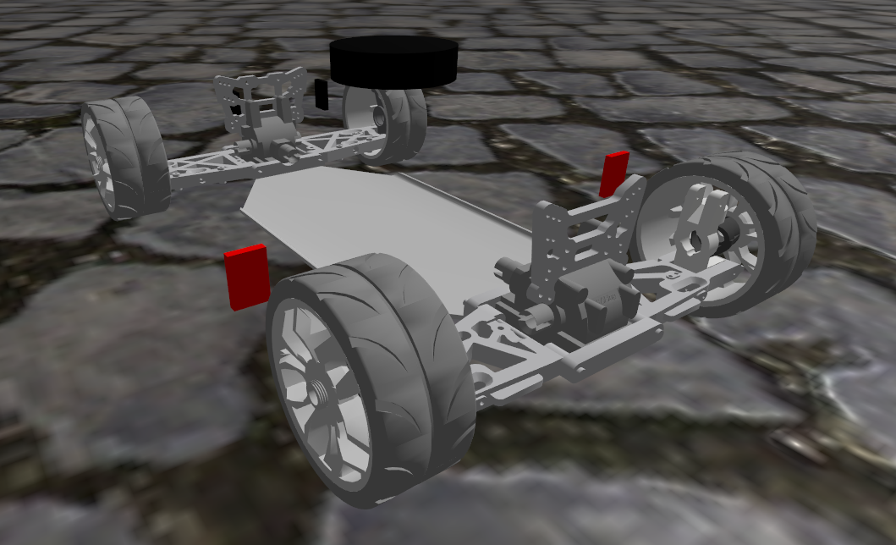

# car_rigid

This is the rigid variant (no suspension). It follows more or less the same steps as the `car_damped` model, but doesnt require any suspension specific tasks.
In the Fusion360 model, the dynamic model including the suspension system is just modified by adding one large rigid group that combines all parts except the wheels and the steering related components.
This simplifies the model tremendously and it is also much more efficient and stable to simulate in gazebo.
Without the usage of `DetachableJoint` for suspension, this model here can be used with both the `dantzig` and `pgs` solvers.



## Change protocol

- finish CAD (all formerly moving parts are combined into a `rigid group` to make them static again. Only wheels and steering joints persist.)
- export SDF using FusionSDF
- load into this directory
- Remove collisions: `python3 remove_collisions.py ../../models/car_rigid/model.sdf ../../models/car_rigid/model.sdf`
- Remove all joints where child and parent reference the same link. (Bug stemming from the FusionSDF plugin exporting a rigid group with joints "inside". Usually you wouldnt use joints in a rigid group, but since we dont want to destroy the "dynamic" model, it's easiest to just combine those links that can be combined rigidly)
- Replace "continuous" with "revolute" joints by hand
- remove base_link_joint and base_link link since those are unnecessary (later we add them again)
- remove links and associated meshes if they are not used by any joint. Happens when you create different rigid groups with the same components
- replace repeated components with only one instance. E.g. FusionSDF exports the 4 wheels as 4 distinct components. We only need one of them.
- Combine and optimize remaining meshes to the collada format. Collada because rviz2 doesnt seem to understand glb format: `python3 sdfopt.py --format dae /workspaces/ros2/src/demo_gazebo/models/car_rigid`
- alter all mesh paths to begin with `package://demo_gazebo`. This is again a workaround to make sure the sdf file is understood both by gazebo and ros2. ros2 cant interpret the `model://car_rigid` prefix.
- replace `rigid_group_147_1` with `base_link`
- add collisions, sensors and ros2_control tags

## Specific settings

### wheel collisions
```xml
<collision name="collision">
  <geometry>
    <sphere>
      <!-- Radius of the collision sphere -->
      <!-- Reason to use a sphere and not a cylinder: With a cylinder, the "real" collision would be an edge. In gazebo this cannot be represented accurately -->
      <radius>0.048</radius>
    </sphere>
  </geometry>
  <surface>
    <friction>
      <ode>
        <!-- Standard friction parameters in the main and secondary directions -->
        <!-- If you want to have less friction, you can either adjust these values or introduce slip -->
        <!-- which is another tag you can set under the ode tag. See the SDFormat specs. -->
        <mu>1.0</mu>     
        <mu2>1.0</mu2>
      </ode>
      <torsional>
        <!-- Torsional friction parameters -->
        <!-- We want to completely disable any torsional friction for the steering to function more stably -->
        <!-- For the rotation of the wheels, this has no effect. -->
        <coefficient>0.0</coefficient> 
        <use_patch_radius>true</use_patch_radius>
        <patch_radius>0.01</patch_radius> 
      </torsional>
    </friction>
  </surface>
</collision>
```

### original ackermann plugin w/o ros2_control
```xml
<plugin element_id="" filename="gz-sim-ackermann-steering-system" name="gz::sim::systems::AckermannSteering">
  <!-- https://gazebosim.org/api/sim/8/classgz_1_1sim_1_1systems_1_1AckermannSteering.html -->
  
  <!-- P gain of how quickly the steering responds. You cannot increase this too much, otherwise you cause instability -->
  <steer_p_gain>50</steer_p_gain>

  <right_joint>wheel_front_right_joint</right_joint>
  <right_joint>wheel_rear_right_joint</right_joint>

  <left_joint>wheel_front_left_joint</left_joint>
  <left_joint>wheel_rear_left_joint</left_joint>

  <right_steering_joint>steering_right_joint</right_steering_joint>
  <left_steering_joint>steering_left_joint</left_steering_joint>

  <!-- [m] distance/length of steering joints-->
  <kingpin_width>0.235</kingpin_width>
  <!-- [radians] limit-->
  <steering_limit>0.8</steering_limit>
  <!-- [m] distance between front and back wheels, meassured on rotation axis-->
  <wheel_base>0.375</wheel_base>
  <!-- [m] distance between front wheels meassured on centre-->
  <wheel_separation>0.260</wheel_separation>
  <!-- [m] radius of the wheels-->
  <wheel_radius>0.05</wheel_radius>
  <min_velocity>-8.0</min_velocity>
  <max_velocity>8.0</max_velocity>
  <min_acceleration>-10</min_acceleration>
  <max_acceleration>10</max_acceleration>

  <odom_topic>/odom</odom_topic>
  <frame_id>odom</frame_id>
  <child_frame_id>base_link</child_frame_id>
</plugin>
```

### rgbd camera
```xml
<!-- *********************** rgbd_camera ************************  -->
<!-- horizontal_fov>1.518436</horizontal_fov: 87 degree as per specification of Realsense D455 -->
<link name="rgbd_camera">
  <pose>0 -0.135 0.3 0.0 0.08 -1.570</pose>
  <inertial>
    <mass>0.001</mass>
    <inertia>
      <ixx>0.0000001</ixx>
      <iyy>0.0000001</iyy>
      <izz>0.0000001</izz>
      <ixy>0</ixy>
      <iyz>0</iyz>
      <ixz>0</ixz>
    </inertia>
  </inertial>
  <sensor name="camera" type="rgbd_camera">
    <camera>
      <horizontal_fov>1.518436</horizontal_fov>
      <image>
        <width>1280</width>
        <height>800</height>
      </image>

      <clip>
        <near>0.01</near>
        <far>100</far>
      </clip>

      <distortion>
        <k1>0.0</k1>
        <k2>0.0</k2>
        <k3>0.0</k3>
        <p1>0.0</p1>
        <p2>0.0</p2>
        <center>0.5 0.5</center>
      </distortion>
    </camera>
    <always_on>1</always_on>
    <update_rate>30</update_rate>
    <topic>rgbd_camera/image</topic>
  </sensor>
</link>
```