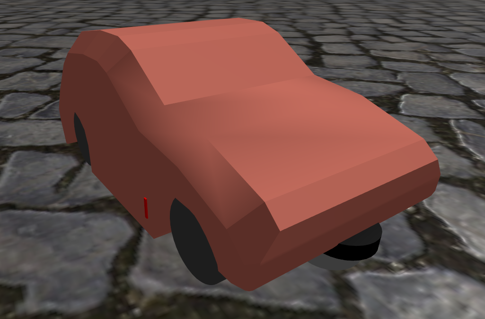

# car_simple model

Not really the most accurate physical model, but close enough given the simplicity of the mesh.

## Change protocol

- finish CAD
- export SDF using FusionSDF
- load into this directory
- Remove collisions: `python3 remove_collisions.py ../../models/car_simple/model.sdf ../../models/car_simple/model.sdf`
- Replace "continuous" with "revolute" joints by hand
- remove base_link_joint and base_link link since those are unnecessary (later we add them again)
- replace repeated components with only one instance. E.g. FusionSDF exports the 4 wheels as 4 distinct components. We only need one of them.
- Combine and optimize remaining meshes to the collada format. Collada because rviz2 doesnt seem to understand glb format: `python3 sdfopt.py --format dae /workspaces/glidar_slam_demo/src/demo_gazebo/models/car_simple`
- alter all mesh paths to begin with `package://demo_gazebo`. This is again a workaround to make sure the sdf file is understood both by gazebo and ros2. ros2 cant interpret the `model://` prefix.
- replace `chassis_1` with `base_link`
- add collisions, sensors and ros2_control tags
